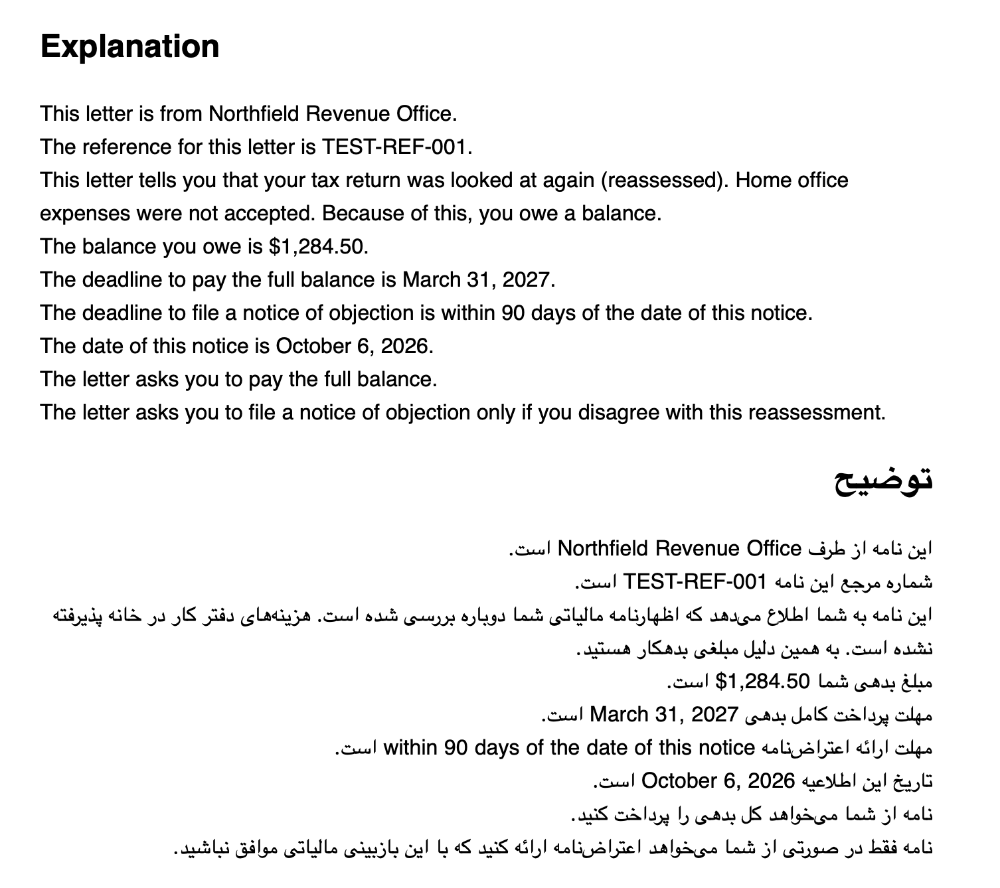
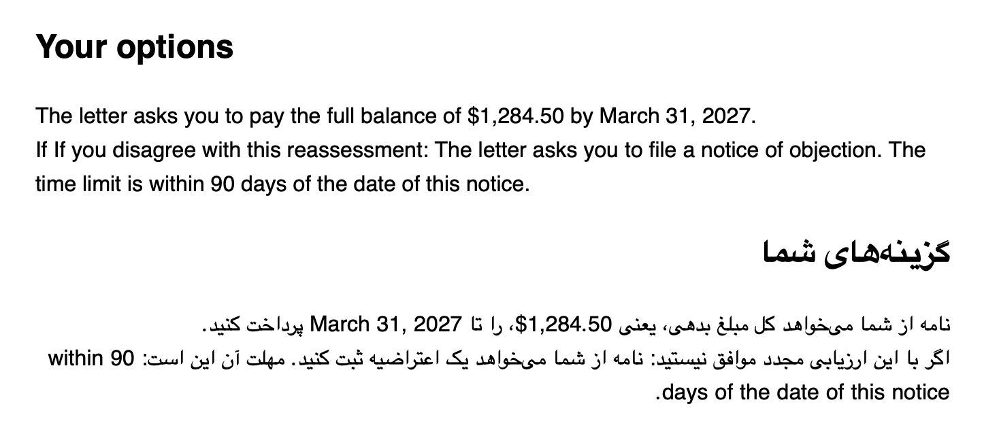
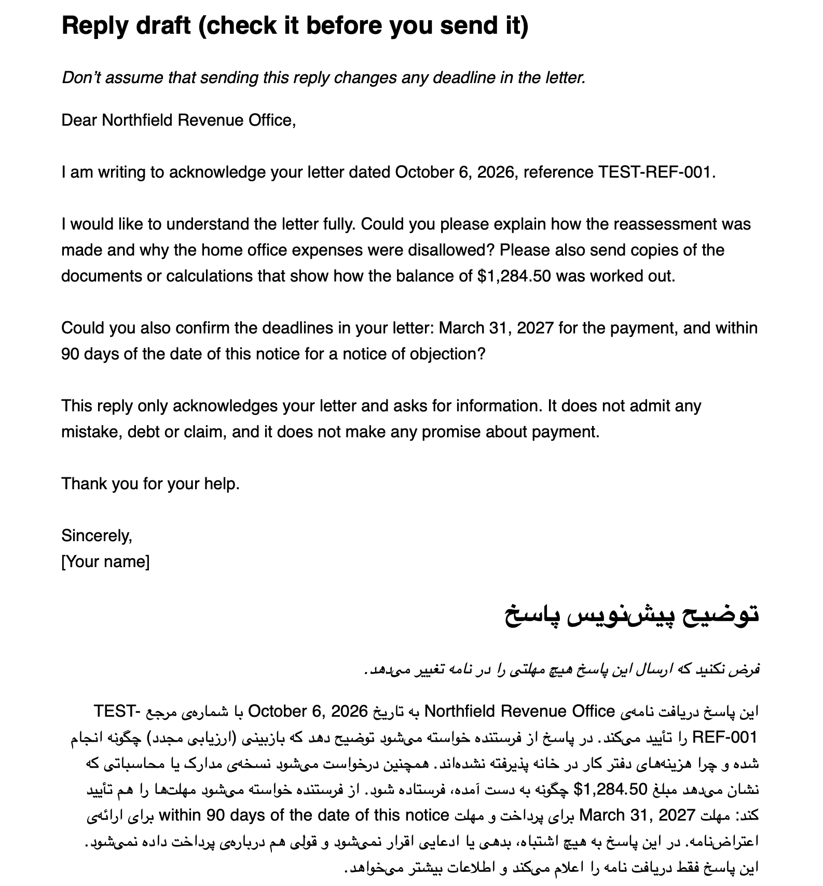

# Letterbox

[](https://github.com/royadeh/letterbox-agent/actions/workflows/tests.yml)

Letterbox explains dense official letters in plain language. It is for
newcomers who read Farsi better than English. From a letter written in English,
it gives:

- a plain-language explanation, in English and then in Farsi
- your options, based only on what the letter asks you to do
- a draft reply in English, with a Farsi explanation of what it says

## How it stays careful

- Every fact it uses must come with the exact sentence from the letter, and
  that sentence is checked against the letter.
- It is designed never to work out a deadline, amount or date itself: the code
  copies them from the letter. If one can't be confirmed, it says "not sure,
  check with the sender".
- The reply draft is checked against a list of phrases that admit fault or
  promise payment. Always review the draft before you send it.
- If it can't give a trustworthy answer, it says "I'm not sure, check with the
  sender", with a short reference code.

## Sample letters

All letters in `data/` are synthetic: the names, senders and references are
made up. Do not paste real letters into this repository.

## How to run it

You need Python 3.10 or later and an Anthropic API key. Letterbox reads the key
from the `ANTHROPIC_API_KEY` environment variable. Set it only in your own
terminal; never put it in a file or commit it.

```sh
pip install .
export ANTHROPIC_API_KEY=...   # in your terminal only
python -m letterbox letter.txt
```

The letter must be a plain text file.

## Input and output

**Input:** one letter, as plain English text in a `.txt` file. All letters in
`data/letters/` are synthetic. Don't use real letters: they contain personal
details, and the text is sent to the Claude API.

Example input:
[`data/letters/001_tax_reassessment.txt`](data/letters/001_tax_reassessment.txt)

```sh
python -m letterbox letter.txt --html out.html
```

**Output:**

- The terminal prints the answer in English, then in Farsi. Terminals draw
  Farsi in the wrong order, so read the Farsi in the HTML page.
- `out.html` is a page with the Explanation, Your options, the Reply draft and
  a disclaimer. The Farsi is shown right to left, and all text is escaped.
- If a fact can't be verified, the page shows "not sure, check with the
  sender" in its place.

Output of one real run on a synthetic letter.







## Running the tests

The automated tests don't call Claude. They feed the program answers I wrote in
advance, including broken and made-up ones, to check that my safety rules catch
them. I ran the real model by hand on one synthetic letter. An evaluation
script exists in `eval/` but has not been run on the full set, so no accuracy
figures are claimed. The tests need no API key and no network.

```sh
pip install ".[dev]"
pytest -q
```

## What the first real run found

The first run with the real model turned up four problems. Each was fixed with
checks and tests:

- The model turned "please pay" into "you must pay".
- The reply draft took a position the reader never chose.
- "within" appeared twice in a deadline.
- A Farsi version of the sender's name was added.

## Limitations

- Numbers written in words, such as "thirty days", may slip past the checks.
- A phrase list can't catch every way of admitting fault or promising payment.
- Tested with automated tests that use answers written in advance. The real
  model was run by hand on one synthetic letter. An evaluation script exists in
  `eval/` but has not been run on the full set, so no accuracy figures are
  claimed.
- The Farsi was read by hand on one letter only.
- The Farsi explanation of the reply draft is checked for wording stronger than
  the letter's. The check can reject the whole explanation, in which case that
  section shows "I'm not sure".
- The options section can show a doubled "If" before a condition ("If If you
  disagree...").
- The Farsi terms for "notice of objection" and "reassessment" vary between
  sections.

## Disclaimer

Letterbox gives general information only. It is not legal or tax advice. Check
anything important with the sender of the letter or with a qualified adviser.
